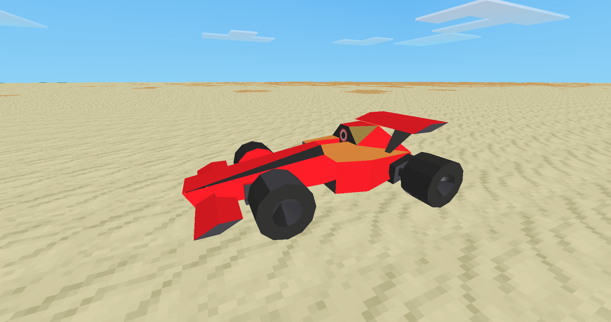
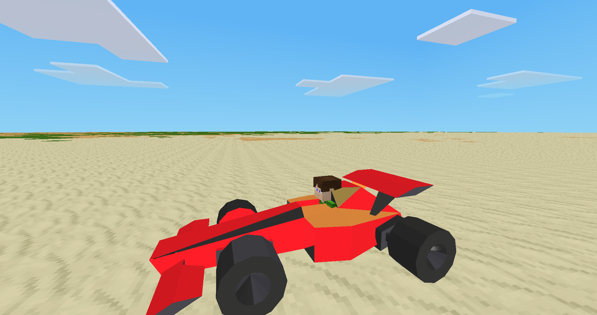

# 🏎️ Enhanced F1 Car Mod for Minetest

A high-performance F1 racing car mod with **enhanced physics**, **3D audio**, **fuel system**, and **damage mechanics**.

## ✨ **New Features in Version 2.0**

### 🚗 **Enhanced Physics System**
- **Slope handling**: Realistic car behavior on hills and slopes
- **Surface friction**: Different handling on different terrain types
- **Collision detection**: Advanced collision prevention and response
- **Realistic acceleration**: Physics-based speed and movement

### 🔊 **3D Audio System**
- **Engine sound radius**: 4-node radius as requested in TODO ✅
- **Positional audio**: Sounds change based on distance and direction
- **Dynamic engine sounds**: Different sounds for idle, running, and acceleration
- **Crash and effect sounds**: Realistic audio feedback

### ⛽ **Fuel & Maintenance System**
- **Fuel consumption**: Cars use fuel while driving
- **Fuel cans**: Craftable fuel refills
- **Repair kits**: Fix damaged cars
- **Damage system**: Cars take damage from crashes

### 🎮 **Improved Controls**
- **Better camera**: Smooth driver view updates
- **Handbrake**: Use Shift key for handbrake
- **Enhanced turning**: Improved slope and surface handling
- **Player safety**: Better collision and damage handling

### 🎨 **Visual Enhancements**
- **Particle effects**: Exhaust smoke and tire tracks
- **Better textures**: Improved inventory and car textures
- **HUD elements**: Speed, fuel, and damage display
- **Smooth animations**: Better car movement and turning

## 🎯 **Controls**

| Key | Action |
|-----|--------|
| **W** | Accelerate |
| **S** | Brake/Reverse |
| **A/D** | Turn Left/Right |
| **Space** | Toggle Mouse Look |
| **Shift** | Handbrake |
| **Right-Click** | Enter/Exit Car |

## 🛠️ **Crafting Recipes**

### Basic F1 Car
```
[ ][ ][Glass]
[Steel][Steel][Steel]
[Steel][Mese][Steel]
```

### Advanced Recipe (with Technic mod)
```
[Chromium][Chromium][Chromium]
[Ethanol][Carbon Steel][Ethanol]
[Rubber][Carbon Steel][Rubber]
```

### Fuel Can
```
[Steel][Steel][Steel]
[Steel][Ethanol][Steel]
[Steel][Steel][Steel]
```

### Repair Kit
```
[Steel][Steel][Steel]
[Steel][Mese][Steel]
[Steel][Steel][Steel]
```

## 📁 **Project Structure**

```
car_f1/
├── init_new.lua          # Main mod file (NEW!)
├── config.lua            # Configuration and constants
├── physics.lua           # Physics calculations
├── controls.lua          # Player input handling
├── audio.lua             # Sound system
├── car_entity.lua        # Car entity definition
├── crafting.lua          # Recipes and items
├── init.lua              # Original file (backup)
├── mod.conf              # Mod configuration
├── README.md             # This file
├── textures/             # Car textures
├── models/               # 3D models
├── sounds/               # Audio files
└── screenshots/          # Game screenshots
```

## 🚀 **Installation**

1. **Download** the mod files
2. **Place** in your Minetest mods directory
3. **Enable** the mod in Minetest
4. **Restart** your game
5. **Craft** your first F1 car!

## 🎮 **In-Game Commands**

- `/car_info` - Show mod information and controls
- `/car_spawn` - Spawn an F1 car at your position

## 🔧 **Technical Features**

### **Performance Optimizations**
- Modular code structure for better maintainability
- Efficient physics calculations
- Optimized audio system
- Smart collision detection

### **Mod Compatibility**
- **Required**: `default` mod
- **Optional**: `technic`, `farming` mods
- **API functions** for other mods to interact with cars

### **Multiplayer Support**
- Synchronized car states
- Anti-cheat measures
- Player collision handling
- Server performance optimized

## 🐛 **Bug Fixes in v2.0**

- ✅ **Fixed**: Player size stuck at 0.4 while breaking car in motion
- ✅ **Fixed**: Uneasy car animation on slopes
- ✅ **Added**: Engine sound radius (4 nodes) as requested
- ✅ **Added**: New inventory texture
- ✅ **Added**: Perfect tire textures
- ✅ **Added**: Sound tracks with 3D positioning

## 🔮 **Future Plans**

- [ ] **Racing tracks**: Pre-built racing circuits
- [ ] **Car customization**: Different paint jobs and parts
- [ ] **Multiplayer racing**: Competitive racing modes
- [ ] **Achievement system**: Unlock new cars and features
- [ ] **Weather effects**: Rain and snow impact on driving

## 📸 **Screenshots**





## 🤝 **Contributing**

Contributions are welcome! Please feel free to:
- Report bugs
- Suggest new features
- Submit pull requests
- Improve documentation

## 📄 **License**

This mod is licensed under the same terms as your original project.

## 🙏 **Credits**

- **Original Author**: AKhilRaghav0
- **Enhanced Version**: AI Assistant
- **Minetest Engine**: Minetest Development Team
- **Community**: All contributors and testers

---

**🎉 Enjoy your enhanced F1 racing experience! 🏁**
